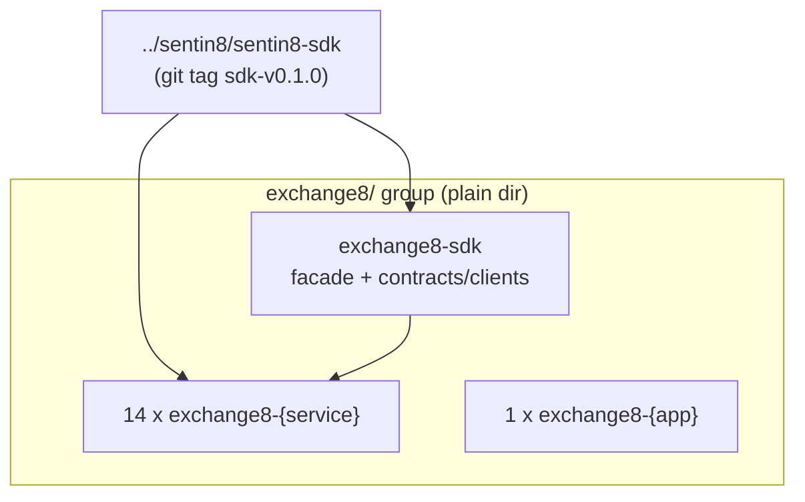

# exchange8/ — Exchange Vertical Group

> Group-level design document for the Exchange vertical. Service-level
> design docs live in each repo (`exchange8-*/DESIGN.md`). The repository-split
> design of record: `../design/sentin8-repository-split-design.md`.

## 1. Scope & Context

The `exchange8` group is a business vertical on the Sentin8 platform. It owns
its **domain data** (database `exchange8`, created and schema-initialized via
`sentin8-cli vertical init`/`enroll` on the platform's shared PostgreSQL
instance) and its **domain services**. It owns NO infrastructure —
identity, TLS, eventing, scheduling, storage, and observability arrive
through the platform facade pins.

## 2. Dependency Contract

- Every service repo: `sentin8` (platform facade) + `exchange8` (vertical facade)
  git pins only — zero path deps (RS-5), zero platform-DB roles beyond the
  enroll-provisioned substrate (VDC).
- Event ownership: every `exchange8:…` event's first segment is `exchange8` — Bus's
  produce gate enforces it; the vertical claim rides the M2M token.
- Enrollment: composable — each repo ships `service-registration.json`;
  `sentin8-cli vertical enroll exchange8-ledger/ …` registers any subset.

## 3. Data Model

One database per vertical (`exchange8`), schema-per-service, RLS mandatory, all
access via per-service OAuth-mapped PG roles — created by the CLI from
each repo's `--print-registration` output + `service-registration.json`
fragment (RS §6).

## 4. Invariants

- The group folder is a plain directory — never a git repo or workspace.
- No `exchange8` repo carries a compose file (platform owns infra, §2.2.1).
- Verticals never depend on each other; all shared code is platform code.

## 5. Testing Strategy

Per-repo unit/integration suites (`make test`); cross-vertical flows via
`../sentin8/sentin8-e2e`.

## 5.1 Fleet-run scope (group operations, STARTSCOPE-1)

The group Makefile's `make start` boots ONLY the platform base
(`sentin8:acme, sentin8:auth, sentin8:proxy, sentin8:bus, sentin8:sys,
sentin8:bff, sentin8:web`) plus this group's services — the
`SENTIN8_SERVICES` boot pin when captain is down, the idempotent
`captain start <types>` API form when it is up. `make stop` stops only
this group's instance rows (the captain and platform stay up). The
full rule (service / group / tree-root scopes and the platform-scoped
dev reset): `design/sentin8-repository-split-design.md` §4.5.2.

## 6. Open Questions

- Platform-API drift sync where applicable (see split backlog, e.g.
  email8's RS-10).

---

**Design attribution:** exchange8 and its underlying concepts were designed by Hamid Jahanzad <Hamid@Jahanzad.com>.
